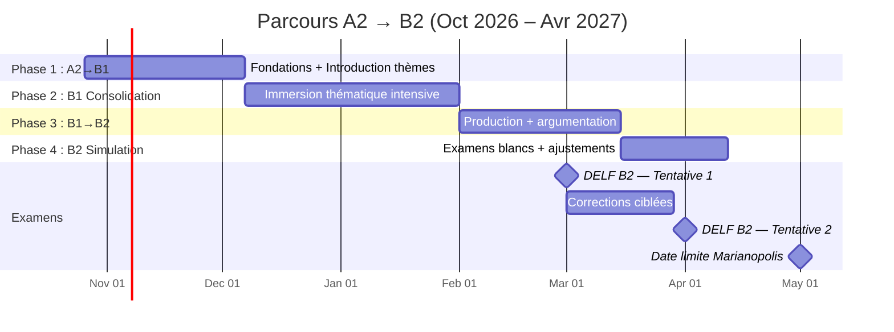

# Objectif B2 — Français par Immersion pour la Médecine

## Contexte

Un adolescent de 16 ans, anglophone au Québec (niveau actuel **A2**), doit réussir le
**DELF B2** avant le **1er mai 2027** pour l'admission à Marianopolis College, avec l'objectif
à long terme d'intégrer le programme Med-P de McGill.

**Délai** : ~27 semaines (25 oct. 2026 → 1er mai 2027). Il passera le test **au moins deux
fois** — une première tentative en février/mars pour identifier les lacunes, une seconde en
avril pour confirmer le score.

**Philosophie pédagogique** : Apprentissage par **immersion et curiosité**. Chaque leçon
utilise du contenu authentique lié à ses intérêts réels (médecine, conduite, travail,
bénévolat) pour créer un sentiment d'**accomplissement concret** — il ne fait pas que
*étudier le français*, il prépare activement son avenir.

---

## Format du DELF B2 — Barèmes Marianopolis

| Module | Compétence | Durée | Pts | Min. Marianopolis |
|---|---|---|---|---|
| Compréhension de l'oral | Écoute de documents authentiques (radio, interviews) | ~30 min | 25 | 5/25 (éliminatoire) |
| Compréhension des écrits | Lecture de textes informatifs et argumentatifs | 1h | 25 | **13/25** |
| Production écrite | Texte argumenté ≥ 250 mots (lettre formelle, essai) | 1h | 25 | **13/25** |
| Production orale | Exposé + débat contradictoire | 20 min (+30 min prép.) | 25 | 5/25 (éliminatoire) |

**Total requis : 67/100** — Note < 5/25 dans n'importe quel module = échec automatique.

---

## Architecture Technique

### Stack
- **Framework** : React 19+ avec TypeScript
- **Build** : Vite
- **Styling** : Tailwind CSS
- **Hébergement** : GitHub Pages (repo `iLanguage/objectif-b2`)
- **CI/CD** : GitHub Actions (lint, test, build verification avant merge)
- **Monitoring** : New Relic Browser Agent (session replay, distributed tracing)
- **Stockage** : localStorage pour progression et scores

### Structure du Repo

```
objectif-b2/
├── .github/
│   └── workflows/
│       ├── ci.yml                  # Lint + test + build on PRs
│       └── deploy.yml              # Build + deploy to GitHub Pages on merge to main
│
├── public/
│   └── _redirects                  # SPA routing for GitHub Pages
│
├── src/
│   ├── main.tsx                    # Entry point
│   ├── App.tsx                     # Router + layout
│   ├── index.css                   # Tailwind imports
│   │
│   ├── components/
│   │   ├── Dashboard.tsx           # Tableau de bord avec progression
│   │   ├── ModuleCard.tsx          # Carte de module sur le dashboard
│   │   ├── LessonView.tsx          # Vue d'une leçon individuelle
│   │   ├── ModeToggle.tsx          # Élève / Professeur / TA toggle
│   │   ├── ProgressBar.tsx         # Barre de progression par module
│   │   └── Timer.tsx               # Chronomètre DELF pour examens blancs
│   │
│   ├── quiz/
│   │   ├── QuizEngine.tsx          # Moteur de quiz générique
│   │   ├── MultipleChoice.tsx      # QCM
│   │   ├── FillInBlank.tsx         # Texte à trous
│   │   ├── Matching.tsx            # Appariement
│   │   ├── WritingPrompt.tsx       # Production écrite (grille + soumission)
│   │   ├── SpeakingPrompt.tsx      # Production orale (instructions + grille)
│   │   └── ScoreDisplay.tsx        # Affichage du score + feedback
│   │
│   ├── modules/
│   │   ├── m0-fondations/          # Module 0: Grammaire A2→B2
│   │   ├── m1-medecine/            # Module 1: Radio-Canada, cardiologie, Med-P
│   │   ├── m2-creperie/            # Module 2: Service client, Vieux-Montréal
│   │   ├── m3-muhc/                # Module 3: Bénévolat hospitalier
│   │   ├── m4-saaq/                # Module 4: Code de la route québécois
│   │   └── m5-delf-blanc/          # Module 5: Examens blancs complets
│   │
│   ├── ta-prompts/
│   │   ├── index.ts                # Registry des prompts TA par leçon
│   │   ├── general-system.md       # Prompt système général pour Gemini TA
│   │   └── [module]-[lesson].md    # Prompt spécifique par leçon
│   │
│   ├── guides/
│   │   ├── GuideProfesseur.tsx     # Guide pour l'enseignant humain
│   │   ├── GuideEtudiant.tsx       # Guide pour l'étudiant (apps, immersion)
│   │   └── GuideTA.tsx             # Guide pour configurer le TA Gemini
│   │
│   ├── data/
│   │   ├── syllabus.ts             # Structure du syllabus (semaines, leçons)
│   │   ├── vocabulary.ts           # Banques de vocabulaire par thème
│   │   └── grilles-delf.ts         # Grilles d'évaluation DELF officielles
│   │
│   └── lib/
│       ├── progress.ts             # Gestion de progression (localStorage)
│       ├── scoring.ts              # Calcul de scores
│       └── newrelic.ts             # Configuration New Relic
│
├── index.html
├── vite.config.ts
├── tsconfig.json
├── tailwind.config.ts
├── postcss.config.js
├── package.json
├── vitest.config.ts               # Configuration des tests
└── README.md
```

---

## Modes d'Utilisation : 3 Vues

### 🎓 Mode Élève (par défaut)
- Voir les leçons, quiz, et sa progression
- Accéder aux instructions pour travailler avec le TA Gemini
- Consulter son guide d'apps Android et d'immersion

### 👨‍🏫 Mode Professeur
- Voir les grilles d'évaluation DELF pour noter la production écrite et orale
- Consulter les notes pédagogiques par leçon
- Voir la progression de l'étudiant et les scores quiz
- Accéder au guide de l'enseignant

### 🤖 Mode TA (Assistant Gemini)
- Afficher les **prompts Gemini** pour chaque leçon — instructions que l'étudiant copie dans son assistant pour pratiquer
- Fournir les critères de correction et d'évaluation pour que Gemini puisse donner du feedback
- Afficher les exercices de pratique supplémentaires pour améliorer les scores faibles
- Chaque leçon a un prompt TA structuré : contexte, objectif, exercices de conversation, vocabulaire cible, critères de réussite

---

## Rôles

### 👨‍🏫 Le Professeur (Humain)
- Conduit les **2 heures de cours hebdomadaires** (2 sessions × 1h)
- Évalue la **production écrite** avec les grilles DELF intégrées
- Mène les **simulations d'oral** (exposé + débat contradictoire)
- Adapte le rythme en fonction de la progression

### 🤖 Le TA — Gemini (Assistant IA)
L'assistant Gemini de l'étudiant sur son **téléphone Android** ou **enceinte connectée**. Pour
chaque leçon, le site fournit un prompt structuré que l'étudiant utilise avec Gemini pour :
- **Pratiquer la conversation** sur le thème de la leçon
- **Réviser le vocabulaire** par répétition espacée
- **S'entraîner aux exercices** de compréhension orale (Gemini lit des textes, pose des questions)
- **Améliorer ses scores** — quand un quiz obtient un score faible, le TA guide des exercices
  ciblés jusqu'à ce que l'étudiant soit prêt à retenter

### 🧑‍🎓 L'Étudiant — Le Pilote de sa Réussite
L'étudiant est le moteur de son apprentissage. Le français n'est pas un obstacle — c'est
**la clé qui ouvre la porte** vers la médecine, la conduite, l'autonomie. Chaque podcast
écouté, chaque conversation avec un client, chaque formulaire lu en français est une victoire
concrète qui le rapproche de son objectif.

**En classe** (2h/semaine) : Travail guidé avec le professeur sur les compétences les plus exigeantes.

**Hors classe — temps d'immersion active** :
- **Trajet en métro/bus** → podcasts Radio-Canada OHdio, musique francophone, anime en VF
- **Temps de divertissement** → séries sur ICI TOU.TV, YouTube en français
- **Pratique avec Gemini** → conversation, vocabulaire, exercices ciblés
- **Week-end** (3h dédiées) → quiz interactifs, production écrite, examens blancs

---

## Plan Pédagogique — Structure Hebdomadaire Parallèle

> [!IMPORTANT]
> Chaque semaine couvre **3 à 4 thèmes en parallèle** pour diversifier le contenu et maintenir
> l'engagement. L'étudiant ne reste jamais bloqué sur un seul sujet.

### Phases du Parcours (A2 → B2 en 27 semaines)



### Exemple de Semaine Type (Phase 2)

| Jour | Durée | Activité | Thème | Mode |
|---|---|---|---|---|
| **Lundi** (cours) | 1h | Grammaire + exercice guidé | Fondations + Médecine | Professeur |
| **Mardi** (trajet) | 30 min | Podcast Radio-Canada OHdio | Médecine | Immersion autonome |
| **Mercredi** (cours) | 1h | Simulation orale ou production écrite | MUHC ou Crêperie | Professeur |
| **Jeudi** (maison) | 30 min | Pratique vocabulaire avec Gemini | SAAQ | TA Gemini |
| **Vendredi** (trajet) | 30 min | Écoute : émission ICI TOU.TV ou anime VF | Immersion libre | Autonome |
| **Samedi** (dédié) | 1h30 | Quiz interactifs + production écrite | Mixte (2-3 thèmes) | TA + autonome |
| **Dimanche** (dédié) | 1h30 | Examen blanc partiel ou révision ciblée | DELF simulation | TA + autonome |

---

## Contenu Détaillé des Modules

### Module 0 — Fondations A2→B2 (Fil conducteur — Semaines 1 à 20)

Compétences transversales réparties sur tout le parcours, intégrées dans les cours hebdomadaires.

| Bloc | Contenu | Semaines |
|---|---|---|
| 0.A | Révision temps de base (passé composé, imparfait, futur) + pronoms | 1–4 |
| 0.B | Subjonctif présent — obligation, sentiment, doute | 5–8 |
| 0.C | Connecteurs logiques (concession, opposition, conséquence, cause) | 9–12 |
| 0.D | Conditionnel + hypothèses (si + imparfait / plus-que-parfait) | 13–16 |
| 0.E | Registres de langue : courant, soutenu, québécois | 17–20 |
| 0.F | Stratégies d'examen : survol, repérage, prise de notes | 20–24 |

---

### Module 1 — Radio-Canada : Médecine & Système de Santé (Semaines 2–22)

**Immersion** : Écouter des extraits réels de Radio-Canada sur la santé au Québec. Lire des articles sur la
pénurie de médecins, les IPS, les réformes. Préparer sa propre candidature Med-P en français.

**Sources authentiques** :
- Radio-Canada OHdio : *Moteur de recherche*, *Les années lumière*
- Articles ici.radio-canada.ca sur le système de santé
- Site McGill Med-P (mcgill.ca/medadmissions)

| # | Leçon | Compétence DELF | Quiz |
|---|---|---|---|
| 1.1 | Vocabulaire des professions médicales | Lecture | QCM + appariement |
| 1.2 | Écoute : reportage sur la pénurie de médecins | Écoute | QCM audio |
| 1.3 | Lecture : article sur les infirmières praticiennes (IPS) | Lecture | Compréhension écrite style DELF |
| 1.4 | Terminologie cardiaque de base | Vocabulaire | Quiz médical |
| 1.5 | Production écrite : lettre de motivation Med-P | Production écrite | Grille B2 |
| 1.6 | Oral : "Quel avenir pour la médecine familiale au Québec ?" | Production orale | Grille exposé |
| 1.7 | Écoute : podcast sur l'IA en médecine | Écoute | QCM + vrai/faux |
| 1.8 | Lecture : texte argumentatif sur la médecine privée vs publique | Lecture | Analyse d'argumentation |

**Prompt TA exemple** (1.2) :
> *Tu es un assistant d'apprentissage du français pour un étudiant de niveau A2/B1 qui veut
> devenir médecin. Après qu'il a écouté un reportage Radio-Canada sur la pénurie de médecins,
> pose-lui 5 questions de compréhension en français simple. Commence par des questions factuelles
> (qui, quoi, où) puis passe à des questions d'opinion. Corrige ses erreurs gentiment en
> reformulant la phrase correcte. Vocabulaire cible : pénurie, médecin de famille, urgences,
> soins de première ligne, CLSC.*

---

### Module 2 — Crêperie Maison Bagatelle : Service Client (Semaines 3–18)

**Immersion** : Simuler le travail en service client dans une crêperie francophone du
Vieux-Montréal. Apprendre à interagir avec des clients, gérer des réclamations, décrire
des plats — des compétences directement utiles pour un vrai emploi.

**Sources** : creperiemaisonbagatelle.shop (menu, ambiance, descriptions)

| # | Leçon | Compétence DELF | Quiz |
|---|---|---|---|
| 2.1 | Accueillir un client et prendre une commande | Oral | Jeu de rôle guidé |
| 2.2 | Vocabulaire gastronomique québécois | Vocabulaire | Appariement + images |
| 2.3 | Gérer une réclamation client (registre soutenu) | Écrit | Rédaction formelle |
| 2.4 | Écoute : conversation rapide entre collègues | Écoute | QCM |
| 2.5 | Production écrite : critique gastronomique du Vieux-Montréal | Écrit | Essai 250+ mots |
| 2.6 | Oral : décrire et recommander un plat à un touriste | Oral | Simulation |

---

### Module 3 — Bénévolat MUHC : L'Hôpital en Français (Semaines 4–20)

**Immersion** : Préparer une vraie candidature de bénévole au MUHC. L'étudiant a 16 ans
(âge minimum d'éligibilité), et la candidature exige le bilinguisme — c'est un objectif
authentique et motivant.

**Source** : muhc.ca/volunteering

| # | Leçon | Compétence DELF | Quiz |
|---|---|---|---|
| 3.1 | Vocabulaire hospitalier : services, départements, urgences | Vocabulaire | QCM contextuel |
| 3.2 | Rédiger une candidature formelle de bénévole | Écrit | Production + grille B2 |
| 3.3 | Entrevue de bénévolat simulée | Oral | Jeu de rôle |
| 3.4 | Écoute : annonces et instructions en milieu hospitalier | Écoute | QCM audio |
| 3.5 | Texte argumentatif : l'importance du bénévolat dans le parcours médical | Écrit | Essai 250+ mots |
| 3.6 | Vocabulaire de la confidentialité et de l'éthique médicale | Lecture | Compréhension écrite |

---

### Module 4 — SAAQ : Code de la Route en Français (Semaines 5–18)

**Immersion** : Le guide officiel SAAQ *Conduire un véhicule de promenade* est un corpus
authentique en français québécois. Maîtriser ce vocabulaire, c'est aussi se préparer à
l'autonomie — conduire au Québec.

**Source** : testdeconnaissances.saaq.gouv.qc.ca + guide SAAQ PDF

| # | Leçon | Compétence DELF | Quiz |
|---|---|---|---|
| 4.1 | Signalisation routière — vocabulaire et panneaux | Vocabulaire | Quiz avec images |
| 4.2 | Règles de priorité et situations de conduite | Lecture | QCM style SAAQ |
| 4.3 | Lire et paraphraser un texte réglementaire | Lecture | Exercice de reformulation |
| 4.4 | Oral : expliquer comment obtenir un permis de conduire au Québec | Oral | Exposé minuté |
| 4.5 | Vocabulaire technique : mécanique, assurance, immatriculation | Vocabulaire | Appariement |

---

### Module 5 — Examens Blancs DELF B2 (Semaines 20–27)

| Composante | Contenu |
|---|---|
| Examen blanc 1 | Thème : Santé & Technologie — timer intégré, correction automatique |
| Examen blanc 2 | Thème : Société & Travail — timer intégré, correction automatique |
| Examen blanc 3 | Simulation complète (4 modules) — thèmes mixtes |
| Guide de l'oral | Fiches : comment structurer un exposé B2 en 20 min |
| Grilles d'évaluation | Grilles DELF pour professeur (production écrite + orale) |

---

## Guide Étudiant : Applications Android & Immersion

> [!TIP]
> Ce guide sera intégré comme page dédiée dans le site. L'idée : **l'étudiant transforme
> son environnement numérique en environnement francophone** sans recourir à la traduction
> intégrale, pour développer l'intuition linguistique.

### Applications recommandées

| App | Usage | Pourquoi |
|---|---|---|
| **Google Gemini** (Android) | TA — pratiquer la conversation, vocabulaire, exercices | Assistant principal du cours |
| **Radio-Canada OHdio** | Podcasts authentiques en français québécois | Compréhension orale — trajet |
| **ICI TOU.TV** | Séries, documentaires, émissions en VF | Immersion divertissement |
| **Crunchyroll** (sous-titres FR) | Anime avec sous-titres français | Motivation + écoute naturelle |
| **YouTube** (changer langue → FR) | Contenu francophone, émissions de vulgarisation | Immersion libre |
| **Linguee** (pas Google Translate) | Dictionnaire contextuel EN↔FR | Comprendre en contexte, pas traduire |
| **Le Conjugueur** | Conjugaison française rapide | Référence grammaire |
| **Google Keep** | Carnet de vocabulaire personnel | Noter les mots nouveaux du quotidien |
| **TalkBack** (Android) | Lecteur d'écran en français | Pratiquer l'écoute en lisant le cours |
| **Spotify** (playlists FR) | Musique francophone québécoise et internationale | Immersion musicale passive |

### Principes d'immersion
1. **Changer la langue du téléphone en français** — interface, notifications, menus
2. **Écouter avant de lire** — ne pas lire la traduction, deviner le sens par le contexte
3. **20 minutes minimum par jour** — podcasts, musique, ou série en français
4. **Noter 3 mots nouveaux par jour** dans Google Keep — les réviser avec Gemini le week-end

---

## Accessibilité

- **Screen reader** : Toutes les pages doivent fonctionner avec TalkBack (Android) et VoiceOver
- **Chrome Mobile + Desktop** : Cible principale — responsive Tailwind
- **Gemini Assistant** : Les pages doivent avoir une structure sémantique claire (headings,
  landmarks, alt text) pour que les assistants IA puissent les lire et les résumer
- **Taille de police** : Minimum 16px, contraste WCAG AA
- **Navigation clavier** : Tous les quiz accessibles au clavier

---

## Monitoring — New Relic

Le script New Relic Browser Agent (SPA loader v1.324.0) sera intégré dans `index.html` avec :
- Session Replay activé (sampling 100%)
- Distributed Tracing activé
- Privacy : mask all inputs, mask text selector `*`
- Account ID : `4464141`, Agent ID : `1120304090`

> [!NOTE]
> Le snippet complet fourni par l'utilisateur sera injecté tel quel dans le `<head>` de
> `index.html`. Aucune modification du script New Relic.

---

## CI/CD — GitHub Actions

### Workflow `ci.yml` (sur chaque PR)
```yaml
- Checkout
- Setup Node 20
- Install dependencies (npm ci)
- Lint (eslint + tsc --noEmit)
- Test (vitest run)
- Build (vite build)
- Check build output exists
```

### Workflow `deploy.yml` (sur merge dans `main`)
```yaml
- Checkout
- Setup Node 20
- Install + Build
- Deploy to GitHub Pages (actions/deploy-pages)
```

---

## Plan d'Exécution — 5 Phases

### Phase 1 — Infrastructure (Semaine 0)
1. Initialiser le projet Vite + React + TypeScript + Tailwind dans le repo
2. Configurer GitHub Actions (ci.yml + deploy.yml)
3. Créer le composant Dashboard, ModeToggle (Élève/Professeur/TA), ProgressBar
4. Implémenter le QuizEngine générique + MultipleChoice + FillInBlank
5. Intégrer le script New Relic dans `index.html`
6. Implémenter le système de progression (localStorage)
7. Premier deploy sur GitHub Pages

### Phase 2 — Module 0 + Module 1 (contenu initial)
8. Rédiger les leçons du Module 0 (fondations A2→B1)
9. Rédiger les leçons et quiz du Module 1 (médecine)
10. Écrire les prompts TA Gemini pour chaque leçon des Modules 0 et 1
11. Créer le Guide Étudiant (apps Android + stratégie d'immersion)

### Phase 3 — Modules 2, 3, 4
12. Créer les leçons et quiz des Modules 2 (crêperie), 3 (MUHC), 4 (SAAQ)
13. Écrire les prompts TA pour chaque leçon
14. Créer les grilles d'évaluation pour le professeur

### Phase 4 — Module 5 : Examens blancs
15. 3 examens blancs B2 complets avec timer et correction automatique
16. Guide de préparation à l'oral avec fiches structurées

### Phase 5 — Guides + finalisation
17. Créer le Guide Professeur et le Guide TA
18. Tests d'accessibilité (screen reader, navigation clavier)
19. Tests de compatibilité Chrome Mobile / Desktop
20. Documentation complète du README

---

## Vérification

### Tests automatisés (CI)
```bash
npm run lint        # ESLint + TypeScript strict
npm run test        # Vitest — tests unitaires des composants quiz
npm run build       # Vite build — vérifier que le site compile
```

### Vérification manuelle
- [ ] Site accessible à `https://ilanguage.github.io/objectif-b2`
- [ ] Mode Élève / Professeur / TA fonctionnels
- [ ] Tous les quiz se chargent, s'auto-corrigent, et sauvegardent le score
- [ ] Progression persistée en localStorage
- [ ] Prompts TA Gemini affichés et copiables pour chaque leçon
- [ ] Guide étudiant Android complet
- [ ] Grilles DELF conformes aux critères officiels
- [ ] 3 examens blancs B2 avec timer
- [ ] Screen reader TalkBack fonctionne sur les pages de quiz
- [ ] New Relic envoie des données de session
- [ ] GitHub Actions passent (lint + test + build) sur chaque PR
